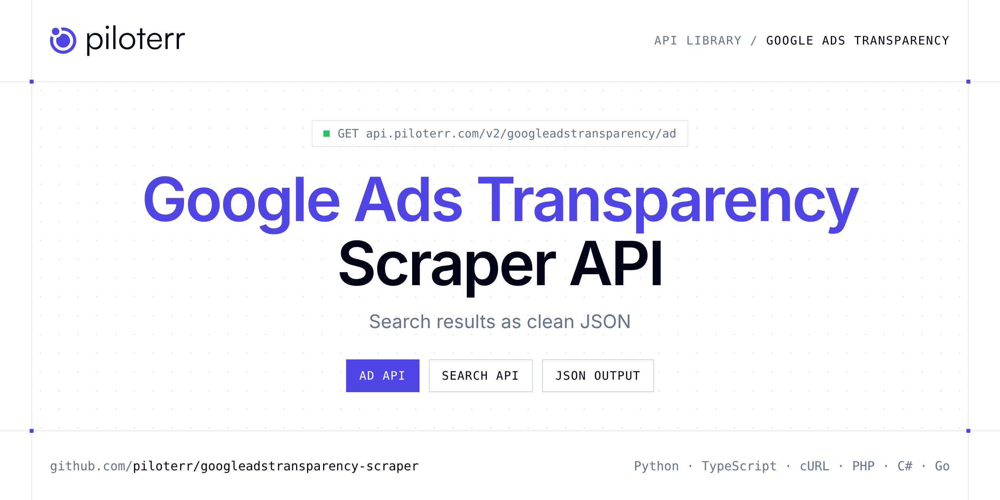

<p align="center">
  <a href="https://www.piloterr.com"></a>
</p>

# Google Ads Transparency Scraper API

[](https://discord.gg/CFj3ph8aHU) [](https://app.piloterr.com) [](https://app.piloterr.com/openapi) [](LICENSE)

The **Piloterr Google Ads Transparency Scraper API** lets you extract public data from Google Ads Transparency as **clean, structured JSON** — no proxies, headless browsers or HTML parsing to maintain. Endpoints available in production:

- **Google Ads Transparency Ad API** — Get one Google Ads Transparency creative by URL: dates, impressions, platforms, regions, and the text read from the preview image (2 credits).
- **Google Ads Transparency Search API** — Search the Google Ads Transparency Center by domain, advertiser, region, format, platform, and date.

Use it for SEO rank tracking, SERP monitoring, ad intelligence, market research or grounding LLM answers with fresh search results.

| Endpoint | Path | Credits | What you get |
|---|---|---|---|
| [Google Ads Transparency Ad API](#google-ads-transparency-ad-api) | `/v2/googleadstransparency/ad` | 2 | Get one Google Ads Transparency creative by URL |
| [Google Ads Transparency Search API](#google-ads-transparency-search-api) | `/v2/googleadstransparency/search` | 2 | Search the Google Ads Transparency Center by domain, advertiser, region, format, platform, and date. Returns creative cards and pagination (2 credits). |

## Table of contents

- [How it works](#how-it-works)
- [Google Ads Transparency Ad API](#google-ads-transparency-ad-api)
- [Google Ads Transparency Search API](#google-ads-transparency-search-api)
- [Code examples in other languages](#code-examples-in-other-languages)
- [Practical use cases](#practical-use-cases)
- [Why Piloterr?](#why-piloterr)
- [FAQ](#faq)
- [Related scrapers](#related-scrapers)
- [Support](#support)

## How it works

1. **Create a free Piloterr account** and copy your API key from the [dashboard](https://app.piloterr.com).
2. **Send a `GET` (or `POST`) request** to `https://api.piloterr.com/v2/...` with the header `x-api-key: YOUR_API_KEY`.
3. **Receive structured JSON** — Piloterr handles rendering, proxies, retries and parsing.

```bash
export PILOTERR_API_KEY="your-api-key"
pip install requests        # Python
# TypeScript: Node.js 18+ (native fetch), run with `npx tsx file.ts`
```

> Every endpoint accepts both `GET` (query string) and `POST` (JSON body with the same fields).

## Google Ads Transparency Ad API

Get one Google Ads Transparency creative by URL: dates, impressions, platforms, regions, and the text read from the preview image (2 credits).

`GET | POST https://api.piloterr.com/v2/googleadstransparency/ad` · **2 credits per request** · [Full reference](https://app.piloterr.com/openapi)

### Request parameters

| Parameter | Type | Required | Description |
|---|---|---|---|
| `query` | string | ✅ | Creative URL from search. |
| `region` | string | — | ISO alpha-2. The matching region is returned first. |

### Python example

```python
import json
import os
import requests

response = requests.get(
    "https://api.piloterr.com/v2/googleadstransparency/ad",
    headers={"x-api-key": os.environ["PILOTERR_API_KEY"]},
    params={
        "query": "https://adstransparency.google.com/advertiser/AR10904289436120383489/creative/CR10927354991047868417?region=FR",
    },
    timeout=60,
)
response.raise_for_status()
data = response.json()

print(json.dumps(data, indent=2, ensure_ascii=False)[:2000])
```

### TypeScript example

```typescript
type GoogleAdsTransparencyAd = {
  url?: string;
  format?: string;
  regions?: {
    region?: string;
    platforms?: unknown[];
    last_shown?: unknown;
    first_shown?: unknown;
    region_code?: number;
    impressions_max?: unknown;
    impressions_min?: unknown;
  }[];
  video_id?: unknown;
  image_url?: unknown;
  platforms?: unknown[];
  last_shown?: unknown;
  variations?: unknown[];
  creative_id?: string;
  first_shown?: unknown;
  image_width?: unknown;
  preview_url?: unknown;
  image_height?: unknown;
  advertiser_id?: string;
  creative_text?: unknown;
  last_shown_at?: unknown;
  first_shown_at?: unknown;
  advertiser_name?: string;
  impressions_max?: unknown;
  impressions_min?: unknown;
};

const params = new URLSearchParams({
  "query": "https://adstransparency.google.com/advertiser/AR10904289436120383489/creative/CR10927354991047868417?region=FR",
});

const response = await fetch(`https://api.piloterr.com/v2/googleadstransparency/ad?${params}`, {
  headers: { "x-api-key": process.env.PILOTERR_API_KEY! },
});
if (!response.ok) throw new Error(`Piloterr error ${response.status}: ${await response.text()}`);

const data = (await response.json()) as GoogleAdsTransparencyAd;

console.log(JSON.stringify(data, null, 2).slice(0, 2000));
```

<details>
<summary><b>POST variant</b></summary>

```http
POST https://api.piloterr.com/v2/googleadstransparency/ad
x-api-key: YOUR_API_KEY
Content-Type: application/json

{"query": "https://adstransparency.google.com/advertiser/AR10904289436120383489/creative/CR10927354991047868417?region=FR"}
```
</details>

### Output example

Example response from the API reference, abridged — real values depend on the page you scrape.

```json
{
  "url": "https://adstransparency.google.com/advertiser/AR10904289436120383489/creative/CR10927354991047868417?region=FR",
  "format": "text",
  "regions": [
    {
      "region": "FR",
      "platforms": [],
      "last_shown": null,
      "first_shown": null,
      "region_code": 2250,
      "impressions_max": null,
      "impressions_min": null
    }
  ],
  "video_id": null,
  "image_url": null,
  "platforms": [],
  "last_shown": null,
  "variations": [],
  "creative_id": "CR10927354991047868417",
  "first_shown": null,
  "image_width": null,
  "preview_url": null,
  "image_height": null,
  "advertiser_id": "AR10904289436120383489",
  "creative_text": null,
  "last_shown_at": null,
  "first_shown_at": null,
  "advertiser_name": "WebAPI Group",
  "impressions_max": null,
  "impressions_min": null
}
```

### Response fields

| Field | Type | Description |
|---|---|---|
| `url` | string |  |
| `format` | string |  |
| `regions[]` | object[] |  |
| `regions[].region` | string |  |
| `regions[].platforms` | any[] |  |
| `regions[].last_shown` | object |  |
| `regions[].first_shown` | object |  |
| `regions[].region_code` | integer |  |
| `regions[].impressions_max` | object |  |
| `regions[].impressions_min` | object |  |
| `video_id` | object |  |
| `image_url` | object |  |
| `platforms` | any[] |  |
| `last_shown` | object |  |
| `variations` | any[] |  |
| `creative_id` | string |  |
| `first_shown` | object |  |
| `image_width` | object |  |
| `preview_url` | object |  |
| `image_height` | object |  |
| `advertiser_id` | string |  |
| `creative_text` | object |  |
| `last_shown_at` | object |  |
| `first_shown_at` | object |  |
| `advertiser_name` | string |  |

## Google Ads Transparency Search API

Search the Google Ads Transparency Center by domain, advertiser, region, format, platform, and date. Returns creative cards and pagination (2 credits).

`GET | POST https://api.piloterr.com/v2/googleadstransparency/search` · **2 credits per request** · [Full reference](https://app.piloterr.com/openapi)

### Request parameters

| Parameter | Type | Required | Description |
|---|---|---|---|
| `query` | string | ✅ | Domain name, advertiser name, advertiser id, or a full Ads Transparency URL. |
| `region` | string | — | Country. ISO alpha-2 (`FR`), `anywhere`, or a Transparency region code (`2250` for France, `250` is also accepted). |
| `domain` | string | — | Domain filter. Used when `query` is not already a domain. |
| `advertiser_id` | string | — | Advertiser id, `AR` followed by digits. |
| `format` | string | — | Creative format. |
| `platform` | string | — | Comma-separated surfaces. |
| `preset_date` | string | — | Relative window. |
| `start_date` | string | — | Inclusive start date, `YYYY-MM-DD` or `YYYYMMDD`. |
| `end_date` | string | — | Inclusive end date, `YYYY-MM-DD` or `YYYYMMDD`. A single day uses the same value as `start_date`. |
| `topic` | string | — | Ad topic. Default: `commercial`. |
| `page` | number | — | Page number, from 1 to 20. Default: `1`. |
| `per_page` | number | — | Page size, from 1 to 100. Default: `40`. |
| `cursor` | string | — | Opaque cursor copied from `pagination.next`. |

### Python example

```python
import json
import os
import requests

response = requests.get(
    "https://api.piloterr.com/v2/googleadstransparency/search",
    headers={"x-api-key": os.environ["PILOTERR_API_KEY"]},
    params={
        "query": "webapi.group",
    },
    timeout=60,
)
response.raise_for_status()
data = response.json()

print(json.dumps(data, indent=2, ensure_ascii=False)[:2000])
```

### TypeScript example

```typescript
type GoogleAdsTransparencySearch = {
  results?: {
    url?: string;
    domain?: string;
    format?: string;
    image_url?: unknown;
    creative_id?: string;
    image_width?: unknown;
    preview_url?: unknown;
    image_height?: unknown;
    advertiser_id?: string;
    last_shown_at?: unknown;
    first_shown_at?: unknown;
    advertiser_name?: string;
  }[];
  pagination?: {
    next?: unknown;
    page?: number;
    per_page?: number;
    total_pages?: unknown;
    total_results?: unknown;
    total_results_max?: unknown;
    total_results_min?: unknown;
  };
};

const params = new URLSearchParams({
  "query": "webapi.group",
});

const response = await fetch(`https://api.piloterr.com/v2/googleadstransparency/search?${params}`, {
  headers: { "x-api-key": process.env.PILOTERR_API_KEY! },
});
if (!response.ok) throw new Error(`Piloterr error ${response.status}: ${await response.text()}`);

const data = (await response.json()) as GoogleAdsTransparencySearch;

console.log(JSON.stringify(data, null, 2).slice(0, 2000));
```

<details>
<summary><b>POST variant</b></summary>

```http
POST https://api.piloterr.com/v2/googleadstransparency/search
x-api-key: YOUR_API_KEY
Content-Type: application/json

{"query": "webapi.group"}
```
</details>

### Output example

Example response from the API reference, abridged — real values depend on the page you scrape.

```json
{
  "results": [
    {
      "url": "https://adstransparency.google.com/advertiser/AR10904289436120383489/creative/CR10927354991047868417?region=FR",
      "domain": "webapi.group",
      "format": "text",
      "image_url": null,
      "creative_id": "CR10927354991047868417",
      "image_width": null,
      "preview_url": null,
      "image_height": null,
      "advertiser_id": "AR10904289436120383489",
      "last_shown_at": null,
      "first_shown_at": null,
      "advertiser_name": "WebAPI Group"
    }
  ],
  "pagination": {
    "next": null,
    "page": 1,
    "per_page": 40,
    "total_pages": null,
    "total_results": null,
    "total_results_max": null,
    "total_results_min": null
  }
}
```

### Response fields

| Field | Type | Description |
|---|---|---|
| `results[]` | object[] |  |
| `results[].url` | string |  |
| `results[].domain` | string |  |
| `results[].format` | string |  |
| `results[].image_url` | object |  |
| `results[].creative_id` | string |  |
| `results[].image_width` | object |  |
| `results[].preview_url` | object |  |
| `results[].image_height` | object |  |
| `results[].advertiser_id` | string |  |
| `results[].last_shown_at` | object |  |
| `results[].first_shown_at` | object |  |
| `results[].advertiser_name` | string |  |
| `pagination` | object |  |
| `pagination.next` | object |  |
| `pagination.page` | integer |  |
| `pagination.per_page` | integer |  |
| `pagination.total_pages` | object |  |
| `pagination.total_results` | object |  |
| `pagination.total_results_max` | object |  |
| `pagination.total_results_min` | object |  |

## Code examples in other languages

Ready-to-run examples live in the [`examples/`](examples) folder. Each one reads your key from the `PILOTERR_API_KEY` environment variable.

| Language | Ad | Search |
|---|---|---|
| cURL (Bash) | [`ad`](examples/curl/ad.sh) | [`search`](examples/curl/search.sh) |
| PHP | [`ad`](examples/php/ad.php) | [`search`](examples/php/search.php) |
| C# | [`ad`](examples/csharp/Ad.cs) | [`search`](examples/csharp/Search.cs) |
| Go | [`ad`](examples/go/ad.go) | [`search`](examples/go/search.go) |
| Java | [`ad`](examples/java/AdExample.java) | [`search`](examples/java/SearchExample.java) |
| Ruby | [`ad`](examples/ruby/ad.rb) | [`search`](examples/ruby/search.rb) |
| Node.js | [`ad`](examples/nodejs/ad.mjs) | [`search`](examples/nodejs/search.mjs) |

## Practical use cases

- **SEO rank tracking** — Track positions of your pages and competitors on target keywords.
- **SERP monitoring** — Watch features, snippets and new entrants on strategic queries.
- **LLM grounding** — Feed AI agents and RAG pipelines with fresh search results.
- **Ad intelligence** — See who advertises on your keywords and with which messages.
- **Market research** — Map competitors, news and trends at scale.

## Why Piloterr?

- **No infrastructure** — no proxies, headless browsers or CAPTCHA solving to run yourself.
- **Structured JSON** — stable, documented fields instead of brittle HTML selectors.
- **Pay per request** — transparent credit cost per endpoint, failed requests are retried for you.
- **One API key, hundreds of sources** — Google Ads Transparency plus many other e-commerce, search and company data endpoints in the [Piloterr library](https://www.piloterr.com/library).
- **Any language** — plain HTTPS + JSON, with examples for Python, TypeScript, cURL, PHP, C#, Go, Java, Ruby and Node.js.

## FAQ

### Is it legal to scrape Google Ads Transparency?

Collecting publicly available data is generally allowed in many jurisdictions, but rules depend on your country, the data you collect and how you use it. Avoid personal data unless you have a lawful basis, respect the website's terms where they apply, and get legal advice for your specific use case. This is not legal advice.

### Do I need proxies or a headless browser?

No. Piloterr handles rendering, proxy rotation and retries on its side. You only send an HTTPS request with your `x-api-key` header and receive JSON.

### How much does a request cost?

Credits per call: `/v2/googleadstransparency/ad` **2**, `/v2/googleadstransparency/search` **2**. See the [Piloterr website](https://www.piloterr.com) for plans.

### What data does the Google Ads Transparency API return?

Each endpoint returns structured JSON: **Google Ads Transparency Ad** — `url`, `format`, `regions[]`, `regions[].region`, `regions[].platforms`, `regions[].last_shown`; **Google Ads Transparency Search** — `results[]`, `results[].url`, `results[].domain`, `results[].format`, `results[].image_url`, `results[].creative_id`.

### How do I paginate Google Ads Transparency results?

Use the `cursor` parameter and keep requesting while the response indicates more results.

### Can I target a specific country or language?

Yes, use `domain`, `region` — see the parameter tables above for accepted values.

### Which languages are supported?

Any language that can make an HTTP request. This README shows Python and TypeScript; the [`examples/`](examples) folder contains cURL, PHP, C#, Go, Java, Ruby and Node.js.

## Related scrapers

- [Bing Scraper API](https://github.com/piloterr/bing-scraper)
- [Brave Scraper API](https://github.com/piloterr/brave-scraper)
- [Google Scraper API](https://github.com/piloterr/google-scraper)
- [All Piloterr scrapers on GitHub](https://github.com/piloterr)

## Support

- 💬 Join the [Piloterr Discord](https://discord.gg/CFj3ph8aHU) to ask questions and share what you build.
- 📚 Browse the [API reference (OpenAPI)](https://app.piloterr.com/openapi) and the [Piloterr library](https://www.piloterr.com/library).
- 🔑 [Get your API key](https://app.piloterr.com).

---

<p align="center">
  <a href="https://www.piloterr.com">
    <picture>
      <source media="(prefers-color-scheme: dark)" srcset="images/logo-dark.svg">
      
    </picture>
  </a>
  <br>
  <sub>Built by <a href="https://www.piloterr.com">Piloterr</a> — web scraping APIs for e-commerce, search, real estate and more, one API key.</sub>
</p>

<sub>Google Ads Transparency is a trademark of its respective owner. This repository is not affiliated with or endorsed by Google Ads Transparency. Examples are released under the MIT license.</sub>
